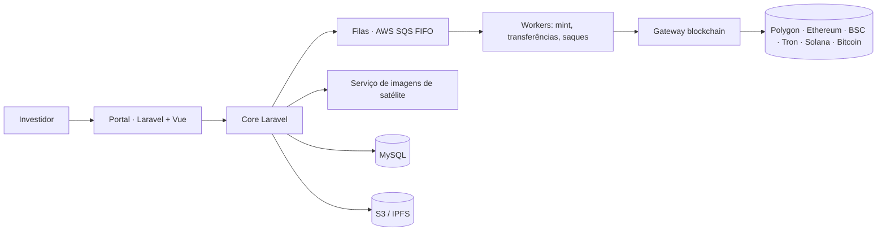

# Photox — Tokenização de créditos de carbono

> Plataforma que transforma áreas de preservação em ativos digitais: créditos de carbono tokenizados, NFTs de área, mercado de negociação e governança on-chain.

> 🔒 **Repositório vitrine.** O código-fonte é proprietário e fica privado. Aqui estão o problema, a arquitetura e as decisões técnicas. Demonstração técnica disponível sob solicitação.

## O problema

O mercado de créditos de carbono é pouco acessível e pouco transparente para o pequeno investidor. A Photox registra áreas de preservação, emite tokens lastreados nelas e permite comprar, vender e acompanhar esses ativos com rastreabilidade em blockchain.

## O que o sistema faz

- **Cadastro de áreas e lotes** com coordenadas e monitoramento por **imagens de satélite**
- **Emissão e mint de tokens** de crédito de carbono e de **NFTs de área**
- **Carteiras custodiais multi-rede**: Polygon, Ethereum, BSC, Tron, Solana e Bitcoin
- **Mercado de negociação** com livro de ordens e motor de trade próprio
- **Depósitos e saques** em reais (gateway de pagamento) e em cripto
- **Governança on-chain**: tokens de governança, propostas e votação
- **Dividendos** distribuídos aos detentores
- **Certificados** de compensação de CO₂
- **Comunidade**: fórum, enquetes e notícias
- **Auditoria** de alterações e conciliação de transações com a blockchain

## Arquitetura

- As operações on-chain (mint, transferência, queima, saque) rodam em **filas FIFO**, garantindo ordem e idempotência.
- Um **gateway blockchain** separado concentra a comunicação com as redes.
- **Rotinas agendadas** conferem saldos e transações pendentes e conciliam com a blockchain.

## Destaques técnicos

- Projeto de longa duração, com mais de 600 commits desde 2023
- Motor de negociação e livro de ordens próprios
- Integração com várias redes blockchain atrás de uma interface única
- Rotinas de verificação de integridade sob carga
- Testes automatizados em PHPUnit

## Stack

| Camada | Tecnologias |
|---|---|
| Backend | PHP, Laravel, filas SQS FIFO, auditoria (laravel-auditing), Spatie Permission |
| Frontend | Vue.js, Blade, Bootstrap |
| Blockchain | Polygon, Ethereum, BSC, Tron, Solana, Bitcoin, NFTs, tokens de governança |
| Infra | AWS S3, SQS, IPFS (Filebase) |

## Status

Parte técnica e integração com blockchain concluídas. A operação comercial aguarda a autorização da CVM.

## Autor

**Felipe Lopes** · Full-stack e fundador da [FML Tech](https://fmlsoftware.com.br)
Arquitetura, backend e infraestrutura blockchain.
